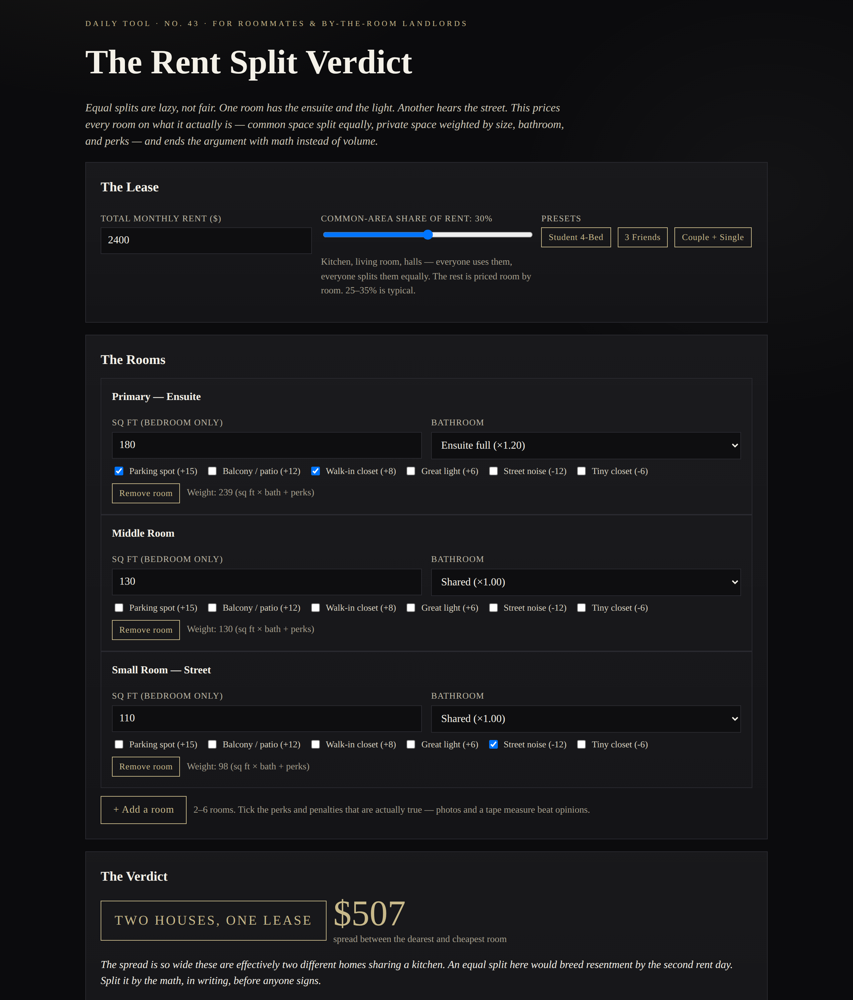

# The Rent Split Verdict

**Live: https://thebullbrew.github.io/rent-split-verdict/**

Equal splits are lazy, not fair. One room has the ensuite and the light. Another hears the street. The Rent Split Verdict prices every room on what it actually is — and ends the roommate argument with math instead of volume.

## What it does

- **Two-pool method:** the common-area share of rent (kitchen, living room, halls — slider, 0–60%) is split equally; the rest is priced room by room
- **Room weighting:** each room's weight = sq ft × bathroom factor (ensuite 1.20 · private half 1.10 · shared 1.00) + perk equivalents in sq ft (parking +15, balcony +12, walk-in closet +8, great light +6, street noise −12, tiny closet −6)
- **Verdict seals:** BALANCED HOUSE / FAIR PREMIUM / TOP ROOM CARRIES / TWO HOUSES, ONE LEASE, by the dearest-to-cheapest ratio, with the monthly spread in dollars
- **Equal-split exposure:** who overpays under a flat split, by how much a month, and what that totals per year
- **Per-room table:** fair rent, share of rent, vs-equal, $/sq ft and weight, with share bars
- **Common-share sensitivity:** 0/15/30/45/60% sweep showing the dearest room, cheapest room and spread at each setting
- **2–6 rooms,** editable names, three presets (Student 4-Bed by-the-room, 3 Friends, Couple + Single), saveable splits in localStorage, and a copy-ready summary for the group chat or the lease file

## The method behind it

Fair rent = (common pool ÷ rooms) + room pool × (room weight ÷ total weight). Common space is genuinely shared, so it is genuinely equal. Private space is not — a 180 sq ft ensuite with parking is a different product from a 110 sq ft street-side room, and pricing them the same is a subsidy, not fairness. Built for roommates splitting a house and for landlords renting by the room, where pricing each room honestly is the whole business model.

## How to run

Open `docs/index.html` in any browser — fully self-contained, works offline as a PWA, no backend, no build step.

*Daily finance & real-estate tool series — one useful tool, every day. Dark aesthetic variation 5 (Noir Marble).*
